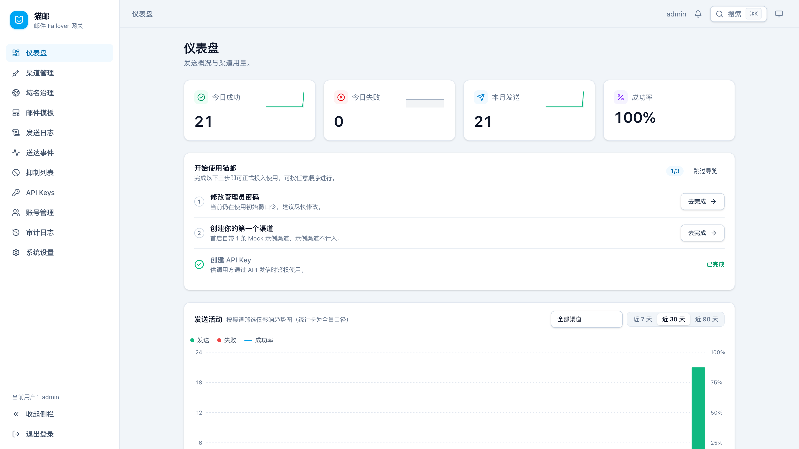
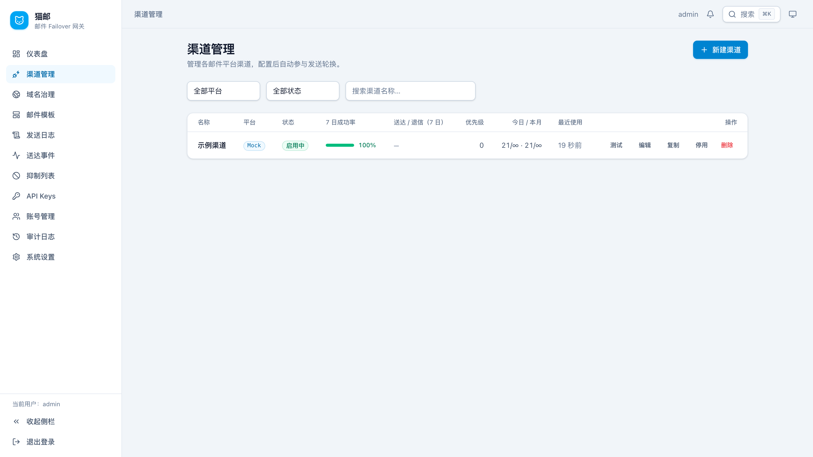
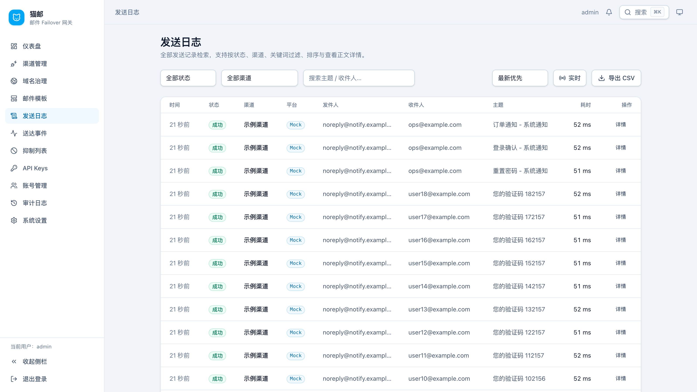
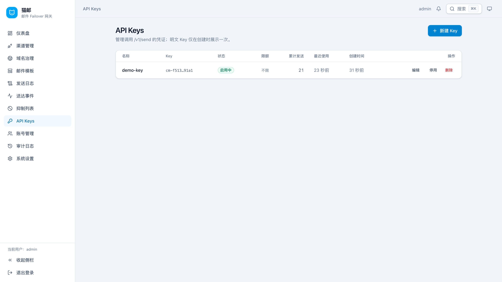
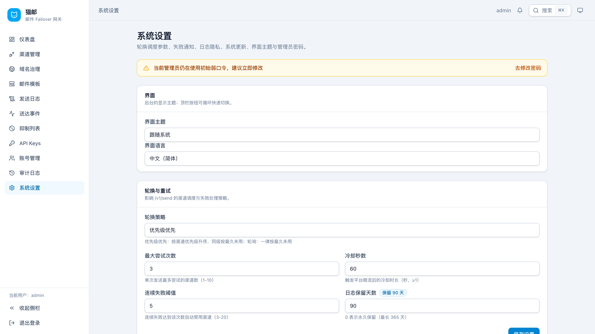
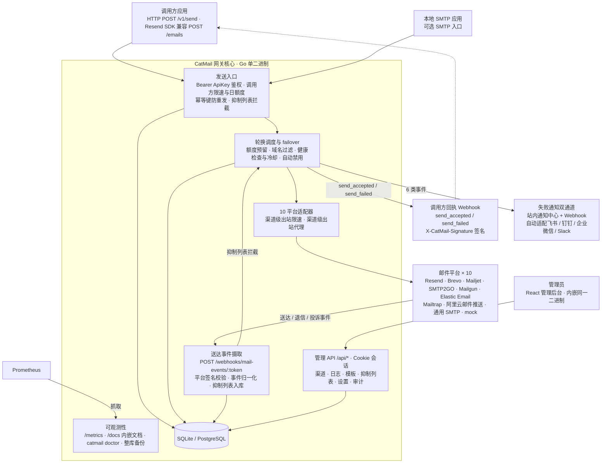

# CatMail（猫邮）

[](LICENSE)   

<!-- 推送到 GitHub 后在此追加 CI / Release / GoReportCard badge 并替换 OWNER -->

**CatMail** 是一个面向个人与小团队的多供应商事务性邮件 **failover 网关**：对内暴露一套统一的发送 API（HTTP + 可选 SMTP 入口），对外连接 Resend、Brevo、Mailjet、SMTP2GO、Mailgun、Elastic Email、Mailtrap、阿里云邮件推送或任意通用 SMTP。当某个渠道不可用（鉴权失败、限流、网络故障）或当日额度已用完时，网关自动切换到下一个可用渠道，并辅以渠道健康检查、自动禁用与冷却恢复，让事务性邮件（注册验证、通知、告警等）尽可能可靠送达。

管理与观测通过内置的中文 Web 管理后台完成，全部能力打包为 **Go 单二进制**（内嵌前端产物 + SQLite/PostgreSQL），开箱即用。

## 截图

内置 Web 管理后台（中文界面；以下为带演示数据的截图，1600×900 @2x）：







<details>
<summary>更多截图：登录页 / API Keys / 系统设置</summary>






</details>

## 特性

- **统一发送 API**：`POST /v1/send`，一套请求格式覆盖所有平台，Bearer ApiKey 鉴权（契约见 [SPEC §2](SPEC.md#2-统一发送-api对外供用户程序调用)）
- **Resend SDK 兼容端点**：`POST /emails` 与 `/v1/send` 完全同构，把 Resend SDK 的 `baseUrl` 指向 CatMail 即可零改造接入
- **按额度与优先级自动轮换**：渠道按优先级排序，额度用尽的渠道自动跳过；支持「优先级优先」与「轮询」两种策略
- **Failover**：单个渠道失败自动尝试下一候选渠道（默认最多 3 次），平台受理成功后绝不换渠道重发；轮换与 failover 算法见 [SPEC「渠道可用性判定与轮换算法」](SPEC.md#渠道可用性判定与轮换算法rotator)
- **10 平台适配器**：Resend / Brevo / Mailjet / SMTP2GO / Mailgun / Elastic Email / Mailtrap / 阿里云邮件推送 / 通用 SMTP / mock（本地模拟，可注入故障演练 failover）；各平台默认额度与逐平台接入要点见 [docs/platforms.md](docs/platforms.md)
- **渠道健康自动禁用与冷却**：平台返回 401/403 自动禁用渠道；429 进入冷却期并自动恢复（Brevo 额度耗尽的 `not_enough_credits` 亦按冷却处理）；连续失败达到阈值自动禁用；渠道列表附带**近 7 天健康度**（成功率 + 失败 Top 原因）
- **额度感知调度**：按日/月统计每个渠道的实际用量，发送前原子预留额度——并发下不超卖、失败自动返还（跨周期按预留锚点配对，不多扣新周期）；跨周期惰性重置
- **调用方配额与限速**：API Key 可设置 `daily_quota`（每日发送上限）与 `rate_per_sec`（令牌桶限速），先限速后额度，被拒不发送、不落日志
- **幂等键防重发**：发送请求可选携带 `Idempotency-Key` 头，重放直接回放首次响应（含失败响应），处理中返回 409，5 分钟僵尸自动认领、24h 懒惰清理；状态机详见 [SPEC](SPEC.md#幂等键防重发e2可选请求头-idempotency-key)
- **渠道级出站限速**：渠道可配置 `rate_limit_per_sec`（令牌桶），超时未取得令牌按「临时不可用」继续 failover
- **失败通知双通道**：站内通知中心（顶栏铃铛）+ Webhook（自动适配飞书/钉钉/企业微信/Slack 机器人）双通道，覆盖渠道自动禁用/进入冷却/冷却恢复/发送失败/发现新版本/退信率超阈值 6 类事件；调用方还可按 Key 配置 `send_accepted`/`send_failed` 回执
- **送达事件与抑制列表**：每渠道独立的送达事件 webhook 地址（`POST /webhooks/mail-events/:token`），接收各平台送达/退信/投诉事件（Resend/Mailgun 真实签名校验）统一存档并关联发送日志；渠道健康度补齐近 7 天送达率/退信率/投诉率与退信率告警；hard bounce 与投诉自动进**抑制列表**，三个发送入口统一拦截被抑制收件人（`recipient_suppressed`）
- **SMTP 入口（可选）**：设 `CATMAIL_SMTP_ADDR` 即启用——只支持 SMTP 的本地应用把 CatMail 当普通 SMTP 服务器用，防开放中继（loopback 免认证、远程强制 ApiKey 认证），发送语义与 API 完全一致；配置证书后明文监听支持 STARTTLS 升级（RFC 3207），并可增开 465 风格隐式 TLS 监听（`CATMAIL_SMTP_TLS_ADDR`）；`CATMAIL_SMTP_TLS_POLICY=require` 强制 AUTH 前必须升级，防明文密码泄露（详见 [docs/smtp.md](docs/smtp.md)）
- **邮件模板**：管理端维护 `{{var}}` 占位符内容骨架（变量自动提取、桌面/移动双预览），三个发送入口经 `template_id` + `variables` 引用渲染；HTML 变量自动转义（无逃生门），缺失变量留空并在响应 `missing_variables` 可见；渲染契约见 [SPEC「邮件模板」](SPEC.md#邮件模板发送入口可选渲染三入口同口径)
- **渠道级出站代理**：每个渠道可配置 HTTP/SOCKS5 代理（SMTP 渠道仅 SOCKS5）
- **域名绑定**：渠道可配置允许的发件域名列表，轮换按发件域名过滤候选渠道
- **运维就绪**：`catmail doctor` 自检、`/metrics` Prometheus 指标、`/docs` 内嵌 OpenAPI 文档页、SQLite 整库备份（VACUUM INTO，保留 10 份）、日志清理三模式、可选 PostgreSQL 存储、GitHub Release 自动更新（强制 SHA-256 校验）
- **审计与安全**：管理操作审计日志（25 类动作，保留 5000 条）、TOTP 两步验证（含 8 个一次性恢复码）、管理面 IP 白名单（CIDR）、登录失败限流（用户名+IP 与用户名双维度、耗时对齐防用户名枚举）
- **安全加固三件套**：渠道凭据 AES-256-GCM 静态加密（`CATMAIL_SECRET_KEY`，启动期自动迁移存量明文）；通知/回执 Webhook 全量签名（`X-CatMail-Signature`，HMAC-SHA256）+ outbox 落库投递（重启不丢、指数退避、10 次转 dead，后台可排查）；会话 v3 + 服务端注册表（可查看/踢出本人会话；管理员重置密码单事务联动吊销会话并停用该用户名下全部 API Key）
- **双语管理后台（中文/English）**：react-i18next 双语界面，浏览器语言自动探测 + 设置页手动切换（即时生效、localStorage 持久化）；浅色/深色/跟随系统三态主题、⌘K 命令面板、可折叠侧栏；页面级功能详见下方「管理后台功能一览」
- **单二进制部署**：前端经 `go:embed` 内嵌，SQLite（纯 Go 实现，无 CGO）或 PostgreSQL 存储，交叉编译友好；提供 Dockerfile/docker-compose 与 GitHub Actions CI

<details>
<summary><strong>管理后台功能一览</strong>（点击展开）</summary>

浏览器打开 `http://localhost:8080`，默认账号见「快速开始」。

| 页面 | 功能 |
|---|---|
| **全局** | 中文界面，浅色/深色/跟随系统三态主题（顶栏循环切换 + 设置页选择，防首屏闪烁）；可折叠侧栏（图标态，状态持久化）；⌘K / Ctrl+K 命令面板（页面导航与快捷操作）；列表加载骨架屏与引导性空态 |
| **仪表盘** | 今日成功/失败、本月发送、成功率四张统计卡（不含「测试发送」，数值大字号 + 迷你趋势图，失败数趋势色反转）；发送活动组合图（发送/失败堆叠柱 + 成功率折线，近 7/30/90 天切换、按渠道筛选，状态同步 URL）；各渠道当日/当月用量进度条与近 7 天健康度，点击统计卡或渠道行可下钻到对应日志；首登显示三步引导清单（改默认口令 → 建渠道 → 建 Key，可跳过） |
| **渠道管理** | 渠道列表（状态徽章：启用/手动停用/自动禁用/冷却；健康度列：近 7 天成功率、送达/退信/投诉率与失败 Top 原因）；平台/状态/关键词筛选；新建、编辑、启停、删除、**复制**；出站限速 `rate_limit_per_sec` 字段；编辑时可显式清除 api_secret/proxy_url/smtp_pass/webhook_secret；单渠道测试发送（支持模板）；查看最近错误与自动禁用原因；渠道详情可复制/轮换**送达事件 webhook 地址** |
| **域名治理** | 按渠道发件域名聚合「域名 × 渠道」矩阵：每域名一张汇总卡，按平台分节展示 SPF/DKIM/DMARC/MX/发件人验证记录与配置指引（静态知识库，纯展示 + 文案复制，不做 DNS 检测）；未配置 `allowed_domains` 的渠道单独归入无限制列表 |
| **邮件模板** | 模板列表与新建/编辑（`{{var}}` 占位符、变量清单自动提取提示）、桌面/移动**双预览**弹窗（样本变量填充后 iframe 沙箱渲染，移动视图固定 375px 手机宽度并排）、删除 |
| **发送日志** | 按状态/渠道/关键词筛选，按时间正/倒序或耗时降序排序，每页 20/50/100 条与跳页；一键导出 CSV（UTF-8 BOM，Excel 打开中文不乱码；行数上限 10000，含公式注入防护）；「实时」开关每 5 秒自动拉新；右侧停靠详情面板（大屏）展示全部字段、错误信息与正文预览（HTML 沙箱 iframe / 纯文本），支持 ↑↓/Enter/Esc 键盘浏览，测试发送单独标记；详情内「重发」按钮（按日志快照重发，30 秒防滥用）；手动「清理日志」（按天数/保留最近 N 条/全部清空三模式） |
| **送达事件** | 平台回传的送达/退信/投诉事件列表（事件类型/退信类型/渠道筛选 + 收件人关键词）；详情面板展示归一化字段与 raw 原始报文（格式化展示），并可跳转关联的发送日志 |
| **抑制列表** | 被抑制收件人列表（bounce/complaint/manual 原因与来源渠道筛选、email 搜索）；手动添加；解除（注明「解除的是当前抑制状态，不是拉黑豁免」） |
| **API Keys** | Key 列表（掩码显示，含累计发送成功数 total_sent、`daily_quota`/`rate_per_sec` 列）、新建（明文仅显示一次）、编辑（回执 Webhook URL/事件白名单/配额/限速）、**回执签名密钥查看/复制/轮换**、回执连通性测试、启停、删除（「密码重置后停用」徽标提示可手动启用） |
| **账号管理** | 多管理员账号的新建、密码重置、删除（不能删自己，至少保留一个账号）；重置密码成功后目标用户全部旧会话立即失效，且**其名下全部 API Key 联动停用**（标记「密码重置后停用，可手动启用」），需重新登录 |
| **失败通知** | 站内通知中心（顶栏未读铃铛 30s 轮询，面板分页浏览/一键全部已读）：渠道自动禁用、进入冷却、冷却恢复、最终发送失败、发现新版本、渠道退信率超阈值六类事件自动推送；可选 Webhook 通道（自动适配飞书/钉钉/企业微信/Slack 机器人，其余发通用 JSON；支持签名密钥生成/轮换，投递经 outbox 重试）；按事件类型开关 + 连通性测试；历史通知每小时清理至最近 1000 条 |
| **审计** | 管理操作审计列表（时间/操作者/动作徽章/目标/详情/IP），按动作前缀（channel/key/user/settings/purge/backup）与操作者筛选、分页；保留最近 5000 条 |
| **系统设置** | 轮换策略（优先级/轮询）、最大尝试次数、冷却秒数、连续失败阈值、日志保留天数（0 = 永久，默认 90 天）；失败通知双通道开关（站内 / Webhook URL / 事件白名单 / 连通性测试 / 签名密钥生成与轮换）；日志正文落库开关（关闭后新日志不存正文）；每日自动备份开关与备份管理（创建/下载/删除，保留 10 份）；两步验证卡片（扫码绑定/启用/恢复码一次性展示/关闭）；**活跃会话卡片**（本人会话列表：来源 IP/设备/最后活跃，踢指定会话/一键下线其余全部）；抑制自动入库开关与退信率告警阈值；弱口令提醒（默认口令未改时提示）；界面主题选择；管理员修改自己的密码（成功后本人其他会话失效，需重新登录） |

</details>

## 架构



术语与行为口径以 [SPEC.md](SPEC.md) 为准（「渠道」「额度预留」「送达事件」等名词均与 SPEC 一致）；调用方接入细节见 [docs/API.md](docs/API.md)，平台接入见 [docs/platforms.md](docs/platforms.md)。

## 性能

- **首屏**：路由级代码分割 + 骨架屏，首屏 JS 较上轮下降约 **54%**（recharts 等重组件按路由懒加载）。
- **大数据量实测**（L5 验收，测试环境：macOS arm64 本机 SQLite，SendLog 预置 10 万行；数据仅为该环境参考值）：日志列表/详情/CSV 导出/统计/渠道列表/Key 列表/通知/审计/仪表盘共 9 个读接口响应 **0.8–160ms**（首字节，含 1 万行 CSV 导出上限场景）；连续 24h 压测无内存泄漏。
- 实现保障：SendLog 按 created_at/channel_id/status/api_key_id 建索引；Key total_sent、统计总览、渠道健康度 Top3 均为单条聚合 SQL（无 N+1）；列表一律分页；响应不缓存保证指标实时。

## 快速开始

### Docker Compose（推荐）

也可以用 Docker 一键构建并运行，无需本地安装 Go/Node。镜像为多阶段构建：Node 构建前端 → Go 交叉编译纯静态单二进制（`CGO_ENABLED=0`）→ Alpine 运行（非 root 用户，附 ca-certificates/tzdata，健康检查探测 `GET /api/health`）。

```bash
# 先按需修改 docker-compose.yml 中的 CATMAIL_ADMIN_USER / CATMAIL_ADMIN_PASS
docker compose up -d --build

# 查看状态与健康检查结果
docker compose ps
docker compose logs -f
```

### Docker 单镜像（docker build + docker run）

```bash
# 在仓库根目录执行；国内镜像源加速已内置，可用构建参数覆盖：
#   --build-arg NPM_REGISTRY=https://registry.npmjs.org
#   --build-arg GOPROXY=https://proxy.golang.org,direct
docker build -t catmail:latest .

docker run -d \
  --name catmail \
  --restart unless-stopped \
  -p 8080:8080 \
  -v ./data:/data \
  -e CATMAIL_ADMIN_USER=admin \
  -e CATMAIL_ADMIN_PASS=admin123 \
  catmail:latest
```

### 数据持久化

- 镜像内通过 `CATMAIL_DB=/data/catmail.db` 把 SQLite 固定到容器 `/data`（覆盖默认的相对路径 `./data/catmail.db`，数据落点不依赖容器工作目录）。
- compose 将宿主 `./data` 挂载到 `/data`：数据库（含 WAL 文件）、日志等全部落在宿主目录，升级/重建容器不丢数据，备份该目录即可。
- Linux 主机上需保证宿主 `./data` 可被容器内用户（uid/gid 1000）写入，首次启动前执行 `sudo chown -R 1000:1000 ./data`；macOS/Windows 的 Docker Desktop 文件共享无需处理。

### 启用 SMTP 入口（可选）

Docker 部署需要同时映射 SMTP 端口并显式设置监听地址（镜像内该功能默认关闭）：

```bash
docker run -d --name catmail \
  -p 8080:8080 -p 2525:2525 \
  -v ./data:/data \
  -e CATMAIL_SMTP_ADDR=:2525 \
  -e CATMAIL_SMTP_MAX_SIZE_MB=25 \
  catmail:latest
```

docker compose 在 `environment` 中加 `CATMAIL_SMTP_ADDR: ":2525"`，并在 `ports` 中加 `- "2525:2525"` 即可。容器内应用属于非 loopback 来源，必须用 API Key 作为 SMTP 密码完成认证（见 [docs/smtp.md](docs/smtp.md#smtp-入口可选)）；认证失败或未认证的连接一律拒绝转发，不会变成开放中继。

> **首次启动后立即改默认口令！** `CATMAIL_ADMIN_USER` / `CATMAIL_ADMIN_PASS`（默认 `admin` / `admin123`）只在数据库还没有任何账号时生效。首次登录后请立即在「系统设置」页修改密码，不要长期依赖环境变量里的初始口令。

经 HTTPS 或反向代理 TLS 终结部署时，在 compose/`docker run` 中加环境变量 `CATMAIL_COOKIE_SECURE=1`（见[安全注意事项](#安全注意事项)）。

### 单二进制下载

> GitHub Release 上线后可用：本仓库尚未推送远端，Release 发布后可从 Releases 页下载对应平台二进制（资产名 `catmail_<os>_<arch>`，SHA-256 校验和随 release 的 `checksums.txt` 提供）。目前请使用 Docker 或下方「源码构建」。

### 源码构建

**环境要求**：Go **1.27+**（见 `backend/go.mod`）；Node.js **20.19+**（Vite 7 要求，仅构建前端时需要）。

后端通过 `go:embed` 打包前端产物，因此**必须先构建前端**，再编译 Go（否则 `backend/internal/web/dist` 不存在，编译会失败）：

```bash
# 1. 构建前端（产物输出到 backend/internal/web/dist）
cd frontend
npm install
npm run build

# 2. 编译单二进制
cd ../backend
go build -o catmail ./cmd/catmail

# 3. 运行
./catmail
```

启动后访问 `http://localhost:8080` 进入管理后台。

**默认管理员账号：`admin` / `admin123`**（仅在数据库中还没有任何账号时按环境变量创建）。首次登录后请立即在「系统设置」页修改密码。

也可以先运行冒烟验证：`curl http://localhost:8080/api/health` 返回 `{"ok":true}`。

首次启动会自动初始化：管理员账号、默认系统设置，以及一条可删除的 **mock 示例渠道「示例渠道」**（本地模拟发送，不产生真实网络请求，可用于体验完整链路与轮换）；接入真实平台、验证 failover 的完整路径见 [docs/platforms.md](docs/platforms.md)。

### 环境变量

| 环境变量 | 说明 | 默认值 |
|---|---|---|
| `CATMAIL_ADDR` | HTTP 监听地址 | `:8080` |
| `CATMAIL_DB` | 数据源：SQLite 文件路径（目录自动创建），或 `postgres://`/`postgresql://` 连接串走 PostgreSQL（备份等 SQLite 专属功能在 PG 上自动停用） | `./data/catmail.db` |
| `CATMAIL_ADMIN_USER` | 首次初始化的管理员用户名 | `admin` |
| `CATMAIL_ADMIN_PASS` | 首次初始化的管理员密码 | `admin123` |
| `CATMAIL_COOKIE_SECURE` | 会话 Cookie 附加 `Secure` 属性（HTTPS/反代 TLS 终结部署时设为 `1` 或 `true`） | 未设置（关闭） |
| `CATMAIL_ADMIN_CIDR` | 管理面 IP 白名单：逗号分隔 CIDR（仅 CIDR 记法，单主机写 `/32`/`/128`），作用于 login、全部会话内 `/api/*` 与 `/metrics`；`/api/health`、`/v1/send`、`/emails`、`/docs` 豁免 | 未设置（不限制） |
| `CATMAIL_TRUSTED_PROXIES` | 可信反代 CIDR 列表（逗号分隔）：设置后 gin 才信任 `X-Forwarded-For` 解析真实客户端 IP；反代部署必须设置，否则 IP 白名单与登录限流的 IP 维度失效 | 未设置 |
| `CATMAIL_SMTP_ADDR` | SMTP 入口监听地址：空 = 功能关闭；如 `:2525` 启用（见 [docs/smtp.md](docs/smtp.md#smtp-入口可选)） | 未设置（关闭） |
| `CATMAIL_SMTP_MAX_SIZE_MB` | SMTP 入口单封邮件 DATA 载荷上限（MB，正整数），EHLO SIZE 广播与超限 552 拒收共用 | `25` |
| `CATMAIL_SMTP_TLS_ADDR` | SMTP 隐式 TLS 监听地址（465 风格）：空 = 关闭；如 `:465` 启用（accept 后立即 TLS 握手，仅在证书已配置时可用） | 未设置（关闭） |
| `CATMAIL_SMTP_CERT_FILE` / `CATMAIL_SMTP_KEY_FILE` | TLS 证书与私钥路径（必须成对配置）：配置后明文监听广播 STARTTLS（RFC 3207）且隐式 TLS 监听可用；未配置维持纯明文现状（见 [docs/smtp.md](docs/smtp.md#smtp-入口可选)） | 未设置（纯明文） |
| `CATMAIL_SMTP_TLS_POLICY` | STARTTLS 策略：`optional`（默认，广播但不强制）/ `require`（明文监听 AUTH 前必须升级，否则 530；需证书已配置） | `optional` |
| `CATMAIL_SECRET_KEY` | 渠道凭据静态加密密钥：base64 编码的 32 字节随机数（`openssl rand -base64 32` 生成），配置后渠道敏感字段 AES-256-GCM 加密落库并自动迁移存量明文；未配置 = 明文兼容，但库中已有密文时拒绝启动（见 [安全注意事项](#安全注意事项)） | 未设置（明文兼容） |
| `CATMAIL_UPDATE_REPO` | 自动更新源仓库（`owner/repo` 格式）：空 = 功能关闭（`/api/update/*` 返回 400） | 未设置（关闭） |
| `CATMAIL_UPDATE_PRERELEASE` | 更新检查是否纳入预发布版本（`1`/`true`） | 未设置（仅正式版） |
| `CATMAIL_UPDATE_CHECK_ON_START` | 启动后异步检查一次更新，发现新版本经通知双通道广播（仅 `CATMAIL_UPDATE_REPO` 已配置时生效） | 未设置（关闭） |

非法取值（CIDR 格式错误、`CATMAIL_SMTP_MAX_SIZE_MB` 非正整数、`CATMAIL_UPDATE_REPO` 非 `owner/repo`、TLS 证书/私钥不可读或不成对、`CATMAIL_SECRET_KEY` 非 base64 或解码后非 32 字节等）一律**启动即退出**（快速失败），绝不带病启动。

> 管理员账号/密码只在首次初始化（数据库无账号）时生效；之后请在后台「系统设置」或「账号管理」中修改。本人修改密码后当前会话保持登录、本人其他会话立即失效；重置任意账号密码后仅该账号的旧会话失效，需重新登录。

## 合规与使用须知

- **每个平台仅注册一个账号**。请不要在同一平台注册多个账号来叠加额度，这违反多数平台的服务条款（ToS）。
- 自动轮换的定位是**容错（failover）与额度感知调度**：在一个账号的额度用尽或平台故障时，切换到你在其他平台的账号继续提供服务，而非规避任何平台限制的工具。
- 各平台**免费额度政策可能随时变化**，本文与后台展示的默认额度仅为配置兜底值，请以各平台官网为准；超额以平台返回的错误为准。
- 请将本项目用于**合法的事务性邮件**（验证码、订单通知、系统告警等），勿用于垃圾邮件或营销群发（各平台对此有单独的合规要求）。
- 请妥善保管管理后台密码与 API Key，建议部署后立即修改默认密码（见 [FAQ](#常见问题)）。

### 安全注意事项

- **默认口令**：首次启动以 `admin` / `admin123` 初始化（可用 `CATMAIL_ADMIN_USER` / `CATMAIL_ADMIN_PASS` 覆盖）。请在首次登录后立即于「系统设置」页修改密码（后台对未修改的默认口令会显示弱口令提醒）；本人修改密码后**当前会话保持登录**，本人其他会话立即失效；重置任意账号密码后仅该账号的旧会话失效。
- **渠道凭据静态加密**：设置 `CATMAIL_SECRET_KEY`（`openssl rand -base64 32` 生成，base64 编码 32 字节）后，渠道的 API Key/Secret/SMTP 密码/代理地址/平台签名密钥以 AES-256-GCM 加密落库（`enc:v1:` 前缀密文），首次配置自动一次性迁移存量明文（幂等）；未配置时明文存储（现状兼容），但库中已有密文或密钥不匹配时**拒绝启动**。备份文件中的凭据天然为密文；更换密钥前请先确认新密钥可解密全部存量密文（doctor 可盘点加密状态）。
- **会话管理（v3）**：登录会话升级 v3 token 并落服务端注册表（升级后旧格式 token 全部失效，需重新登录一次）；「系统设置」页可查看本人活跃会话（来源 IP/设备/最后活跃）、踢出指定会话或一键下线其余全部。管理员重置他人密码时单事务联动：该用户全部会话吊销 + 其名下全部 API Key 停用（标记「密码重置后停用」，可手动启用）。
- **Webhook 签名**：通知 Webhook 与调用方回执均附带 `X-CatMail-Signature: t=<unix秒>,v1=<hex>` 签名头（HMAC-SHA256，±5 分钟容差）；通知密钥在设置页生成/轮换，回执密钥创建 Key 自动生成、可轮换；**secret 未配置时不签名、不发签名头**，接收方校验逻辑请按此兼容（校验示例见 [docs/API.md](docs/API.md)）。
- **发送日志落正文（隐私提示）**：为便于排障，发送日志默认**完整存储邮件正文**（HTML/纯文本）与收件人、主题、错误信息，日志详情面板可查看。请把 `data/` 目录与 SQLite 文件当作敏感数据保护（备份、迁移、磁盘镜像时同样注意）；对隐私敏感的场景可调低「日志保留天数」定期自动清理（默认 90 天，0 = 永久保留）。
- **API Key**：明文 key 仅在创建时显示一次；怀疑泄露时立即在「API Keys」页停用或删除。所有发送接口均为 Bearer 鉴权，请勿把 key 硬编码进前端或公开仓库。
- **传输安全**：管理后台会话 Cookie 默认 `HttpOnly + SameSite=Lax`；经 HTTPS 或反向代理 TLS 终结部署时设置环境变量 `CATMAIL_COOKIE_SECURE=1` 附加 `Secure` 属性。建议不要把管理后台直接暴露在公网，置于内网或反代鉴权之后。
- **防爆破**：管理后台登录内置失败限流（同 用户名+IP 或同用户名 10 分钟内失败 5 次即锁定 15 分钟；不存在的用户走等时长 bcrypt 哨兵比对，响应时间不泄露用户名是否存在）。
- **两步验证（TOTP）**：账号可绑定 TOTP 认证器（登录需 6 位动态码），启用时一次性返回 8 个恢复码（仅存 sha256）；密码泄露之外多一层防护。
- **管理面 IP 白名单**：设置 `CATMAIL_ADMIN_CIDR` 后，登录接口、全部管理 API 与 `/metrics` 仅接受白名单网段来源（`/api/health`、发送入口豁免）；反向代理部署需同时设置 `CATMAIL_TRUSTED_PROXIES`，真实客户端 IP 才可信。
- **审计日志**：渠道/Key/账号/设置/备份等 15 类管理操作成功后记录「谁在何时从哪个 IP 做了什么」（不含秘钥/密码等敏感值），后台「审计」页可按动作与操作者筛选，保留最近 5000 条。

## 文档索引

| 文档 | 内容 |
|---|---|
| [docs/API.md](docs/API.md) | 发送 API 全量指南：认证、请求/响应与错误码、channel 轮换语义、邮件模板、幂等键、送达回执与送达事件 Webhook、SMTP 接入、[运维与观测](docs/API.md#11-运维与观测)、[FAQ](docs/API.md#12-常见问题faq)、[管理 API 端点一览](docs/API.md#附录管理-api-端点一览) |
| [docs/platforms.md](docs/platforms.md) | 渠道接入指南：支持的平台与默认额度、接入步骤、SPF/DKIM 域名规划、逐平台接入要点与真实平台接入清单 |
| [docs/smtp.md](docs/smtp.md) | SMTP 入口：启用方式、防开放中继、STARTTLS 与隐式 TLS、模板报文头指令、Docker 端口映射 |
| [SPEC.md](SPEC.md) | 前后端行为契约（接口细节的唯一权威来源） |
| [CONTRIBUTING.md](CONTRIBUTING.md) | 开发环境、测试门禁、提交信息与 PR 流程 |
| [CHANGELOG.md](CHANGELOG.md) | 面向使用者的变更日志 |

运行中的服务还可打开内嵌文档页 `/docs`（OpenAPI 3.1，零外部依赖，规范原文在 `/docs/openapi.yaml`）。

## 开发

**后端**：Go + Gin + GORM + glebarez/sqlite（纯 Go SQLite，无 CGO）+ gorm postgres 驱动 + robfig/cron v3 + pquerna/otp（TOTP）+ google/uuid；定时任务负责冷却到期恢复、通知/审计裁剪、每日备份与日志过期清理。
**前端**：React 19 + Vite 7 + TypeScript + Tailwind CSS v4 + react-router v7 + @tanstack/react-query v5 + recharts。

```bash
# 测试（CI 同款门禁）
cd backend && go test -race ./... && gofmt -l . && go vet ./...

# 构建（必须先前端后后端，go:embed 依赖前端产物）
cd frontend && npm install && npm run build
cd ../backend && go build -o catmail ./cmd/catmail

# E2E（Playwright，自动拉起一次性后端，固定端口 18100，全程 mock 渠道不出网）
cd frontend && npm run e2e
```

集成冒烟走 `scripts/smoke.sh`（端口 18080）。开发环境、i18n 门禁、提交信息与 PR 流程详见 [CONTRIBUTING.md](CONTRIBUTING.md)。发布：打 `v*` tag 即自动发布（`.github/workflows/release.yml` 产出全平台二进制 + checksums.txt 与 ghcr 镜像）；版本号经 `-ldflags "-X catmail/internal/version.Version=vX.Y.Z"` 注入，未注入显示 `dev`。

<details>
<summary>仓库目录结构</summary>

```text
CatMail/
├── SPEC.md                  # 前后端实现契约（接口细节的唯一权威来源）
├── PLAN.md  CHANGELOG.md    # 实施计划 / 变更日志
├── research/                # 平台与选型调研报告
├── Dockerfile  docker-compose.yml  .github/workflows/ci.yml
├── scripts/                 # smoke.sh 集成冒烟 · e2e-server.sh（Playwright 一次性后端）
├── backend/
│   ├── cmd/catmail/        # 主程序入口（路由装配 + SPA 静态资源 + SMTP 入口启停 + doctor 子命令 + 优雅退出）
│   └── internal/
│       ├── config/          # 环境变量配置（非法值启动即快速失败）
│       ├── model/           # GORM 数据模型（User/Setting/ApiKey/Channel/SendLog/IdempotencyRecord/AuditLog/Notification + Template/MailEvent/Suppression/Session/WebhookDelivery）
│       ├── store/           # SQLite|PostgreSQL 自动选方言、迁移、首启初始化、VACUUM INTO 备份族、凭据加密启动期迁移
│       ├── provider/        # 平台适配器（10 平台）+ 默认额度 + 共用出站 HTTP 栈（代理/限速读取上限）
│       ├── rotator/         # 轮换调度引擎（额度预留/域名过滤/failover/冷却/自动禁用/渠道级令牌桶/抑制列表拦截）+ 通知与回执埋点
│       ├── api/             # /api/* 管理 API + /v1/send、/emails 发送入口 + /metrics + 幂等/审计/Key 策略 + 送达事件入站端点
│       ├── smtpserver/      # SMTP 入口（可选启用）：防开放中继 + STARTTLS/隐式 TLS + 模板报文头指令 + 状态码映射
│       ├── inbound/         # 送达事件入站基础设施（Svix/Mailgun 签名校验 + 事件归一化 + 退信率告警）
│       ├── render/          # 邮件模板 {{var}} 渲染（HTML 转义/点路径/缺失变量收集）
│       ├── secretcrypt/     # 渠道凭据 AES-256-GCM 静态加密（CATMAIL_SECRET_KEY）
│       ├── httpsig/         # 出站 Webhook 签名契约（X-CatMail-Signature）
│       ├── outbox/          # Webhook 投递 outbox（退避重试/10 次转 dead/签名投递）
│       ├── notify/          # 管理员通知双通道（站内 + Webhook，6 事件，webhook 经 outbox 投递）
│       ├── receipt/         # 调用方 Webhook 回执（send_accepted/send_failed，经 outbox 投递）
│       ├── scheduler/       # cron 定时任务（outbox 投递驱动、冷却释放、通知/审计/会话/投递记录裁剪、每日备份、日志清理）
│       ├── doctor/          # catmail doctor 自检（8 大项）
│       ├── update/          # 自动更新：GitHub Releases 检查 + SHA-256 校验原子落盘
│       ├── version/         # 版本号单一来源（-ldflags 注入）
│       ├── docs/            # /docs 内嵌文档页 + openapi.yaml
│       └── web/             # go:embed 前端产物 dist/（构建生成）
└── frontend/                # React SPA（构建产物输出到 backend/internal/web/dist；e2e/ 为 Playwright 用例）
```

</details>

## 常见问题

**额度是如何统计与重置的？**
按渠道独立统计。只有平台**受理成功**才消耗额度（`used_day`/`used_month` +1）；跨日/跨月采用惰性重置——下次发送时发现记录的周期锚点不是今天/本月，即清零重新计数，无需定时任务。展示的「默认额度」可在渠道表单中覆盖，0 表示不限（交给平台报错兜底）。

**渠道被自动禁用（红色徽章）怎么办？**
在「渠道管理」查看该渠道的「最近错误」与「自动禁用原因」：401/403 通常是 API Key 失效或被平台封禁；连续失败多为网络/域名配置问题。修复后在渠道上手动「启用」即可恢复。黄色「冷却」徽章是临时限流退避，到期（默认 60 秒）由定时任务或下次发送自动复位，无需人工干预。

**如何查看送达情况？**
「仪表盘」的成功率与近 30 日趋势基于 CatMail 受理结果统计。注意「平台受理」不等于「最终送达」：在渠道详情复制**送达事件 webhook 地址**并配置到对应平台后，送达/退信/投诉事件会经 `POST /webhooks/mail-events/:token` 自动汇入「送达事件」页（与发送日志双向关联），渠道健康度也会补齐近 7 天送达率/退信率/投诉率，hard bounce 与投诉收件人自动进抑制列表防止继续投递；未配置事件回传时，投递后状态请到各平台控制台查看。

**如何备份与迁移数据？**
全部业务数据都在 SQLite 单文件中（默认 `backend/data/catmail.db`，运行时伴随 `-wal`/`-shm` 文件）。推荐用「系统设置 → 备份管理」：一键 `VACUUM INTO` 整库快照（服务不停机、自动保留最近 10 份）并下载；也可以停止服务后整体拷贝 `data/` 目录。迁移到新机器时把备份文件放到对应位置（或用 `CATMAIL_DB` 指向该文件）后启动即可。PostgreSQL 数据源请用 `pg_dump`/`pg_restore`（CatMail 内置备份接口在 PG 上明确拒绝）。日志默认保留 90 天，可在「系统设置」调整（0 = 永久保留）。

**部署后如何体检与升级？**
体检：运行 `./catmail doctor`，8 大项只读自检（配置/磁盘/数据库/渠道完整性/端口等），任一 FAIL 退出码为 1，可挂在监控脚本里定期跑。升级：配置 `CATMAIL_UPDATE_REPO` 后可在后台一键检查并应用 GitHub Release 新版本（强制 SHA-256 校验，重启生效）；Docker 部署请直接拉新镜像重建容器（数据在挂载卷中不受影响），也可观察「失败通知」里 `update_available` 事件的提醒。

## License

[AGPL-3.0](LICENSE) © 2026 Misyra
